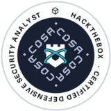
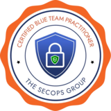
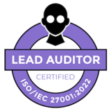
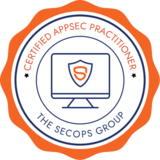
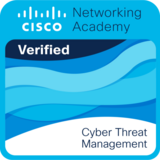

# Effa binte Ashfaq

**Security Researcher · GRC Analyst · Blue Team** · Islamabad, Pakistan

&nbsp;
&nbsp;

### About

I'm Effa, also known as `3FFYP4CK`. I work in GRC and blue team security: audits, risk and ISO standards on one side, logs and investigations on the other. Currently doing a Masters in Information Security at MCS, NUST.

### Certifications

&nbsp;
&nbsp;
&nbsp;
&nbsp;
&nbsp;

### What I do

<table>
<tr>
<th align="left" width="50%">Blue Team</th>
<th align="left" width="50%">GRC</th>
</tr>
<tr>
<td valign="top">

- SIEM and log analysis
- Threat hunting
- Windows and Active Directory attack analysis
- Network traffic analysis and IDS
- Malware analysis and DFIR
- Incident reporting

</td>
<td valign="top">

- Security audits and compliance
- Risk assessment and treatment
- Control mapping and governance
- Policy development
- Audit preparation and evidence
- Security documentation

</td>
</tr>
</table>

**Frameworks:** ISO/IEC 27001 · ISO/IEC 27701 · PCI DSS · PDPL (KSA) · SAMA

### Security disclosures

| CVE | Product | Severity | Summary |
|---|---|---|---|
| [CVE-2026-112339](https://github.com/wazuh/wazuh/security/advisories/GHSA-v8ww-qhjh-j6w9) | Wazuh | Moderate (CVSS 5.9) | Missing TLS hostname verification in the fluent-forward module let any certificate from the configured CA impersonate the Fluentd collector. Fixed in 4.14.9. |
| [CVE-2026-66874](https://github.com/go-gitea/gitea/security/advisories/GHSA-5xp7-r6cr-39ff) | Gitea | Moderate (CVSS 6.5) | A fork pull request could pass a required status check without any workflow running, bypassing branch protection. Fixed in 1.27.3. |

### Recent writing

- [From Clearing HTB CDSA to Teaching Blue Team Security](https://effabinteashfaq.vercel.app/writeups/cdsa-journey/): preparing for and passing the CDSA exam, then teaching it in a workshop.
- [One Control, Five Frameworks](https://effabinteashfaq.vercel.app/writeups/one-control-five-frameworks/): mapping one access control across five frameworks so the audit work is done once.
- [Lattice Cryptography Without the Heavy Maths](https://effabinteashfaq.vercel.app/writeups/lattice-cryptography-without-the-heavy-maths/): a plain-language introduction to lattice-based cryptography and why it holds up against quantum computers.

### Tools

**SIEM and logs:** Splunk · Elastic Stack / Kibana · Sysmon · Sigma 
**Forensics and malware:** Volatility · Autopsy · FTK Imager · KAPE · YARA 
**Network:** Wireshark · Nmap 
**Testing:** Burp Suite · Metasploit

---

Open to GRC and SOC opportunities

